# Quantile Regression with B-splines

Anton Antonov    
[RakuForPrediction at WordPress](https://rakuforprediction.wordpress.com)   
October 2026

## Introduction

This document ([notebook](https://github.com/antononcube/Raku-Math-QuantileRegression/blob/main/docs/Quantile-Regression-with-B-splines.ipynb)) 
has explanations and examples of using the function `quantile-regression` provided by the Raku package ["Math::QuantileRegression"](https://github.com/antononcube/Raku-Math-QuantileRegression), [AAp1].

The function `quantile-regression` computes [Quantile Regression (QR)](https://en.wikipedia.org/wiki/Quantile_regression) fits over a time series, a list of numbers or a list of numeric pairs using B-spline bases.

**Remark:** This notebook closely follows the page of the Wolfram Function Repository entry [`QuantileRegression`](https://resources.wolframcloud.com/FunctionRepository/resources/QuantileRegression/), [AAp3].
Similar notebook was made for the Python package ["QuantileRegression"](https://pypi.org/project/QuantileRegression/), [AAp2].

---

## `quantile-regression`

`quantile-regression(@data, $knots, @probs)`    
does quantile regression over the times series or data array data using the knots specification knots for the probabilities probs.

`quantile-regression(@data, $knots, @probs, *%opts)`    
does quantile regression with the options opts.

`quantile-regression(@data, :$knots, :@probs, *%opts)`    
does quantile regression with named arguments.

### Details & Options

- `quantile-regression` works on numerical arrays, lists of numbers, and lists of numeric pairs.


- The curves computed with quantile regression are called **regression quantiles**.


- The regression quantiles corresponding to the specified probabilities are linear combinations of B-splines generated over the specified knots.


- In other words, `quantile-regression` computes fits using a B-spline functions basis. The basis is specified with the `knots` argument and the option `:order(:$interpolation-order)`.


- The named argument `:order(:$interpolation-order)` is 3 by default.


---

## Setup

```raku
use Data::Importers;
use Data::Generators;
use Data::TypeSystem;

use Stats;
use Statistics::Distributions;
use Statistics::OutlierIdentifiers;

use Math::QuantileRegression;
use Math::Polynomial::Chebyshev;

use JavaScript::Google::Charts;
```

```raku
my $backgroundColor = '#1A1A1A';
my $format = 'html'; 
my $titleTextStyle = %(color => 'DarkGray', fontSize => 16);
my $chartArea = {
    :$backgroundColor,
    left => 50,
    right => 100,
    top => 50, 
    bottom => 50
}

# Offset from 1900-01-01 to 1970-01-01
my $date-offset = 2208988800;
```

```raku
sub qr-plot(
        @data where @data.all ~~ Positional:D,
        @q-funcs where @q-funcs.all ~~ Callable:D,
        @probs where @probs.all ~~ Numeric:D,
        Int:D :$width = 800,
        Int:D :$height = 600,
        :$pointColor = 'SteelBlue',
        Bool:D :$date-plot = False,
        Numeric:D :$date-offset = 2208988800,
        :$format = 'jupyter',
        *%args
        --> Str:D
        ) {
    die 'There must be one quantile function for each probability.'
    unless @q-funcs.elems == @probs.elems;
    die 'Data must consist of numeric predictor-response pairs.'
    unless @data.grep(-> $row {
            $row.elems >= 2 && $row[0] ~~ Numeric:D && $row[1] ~~ Numeric:D
    }).elems == @data.elems;

    my @column-names = 'x', 'data', |@probs.map(*.Str);
    my @records = @data.map(-> $row {
        my $x = $row[0];
        my $x2 = $date-plot ?? DateTime.new(Instant.from-posix($row[0] - $date-offset)) !! $row[0];
        my @values = $x2, $row[1], |@q-funcs.map(-> &fit { &fit($x) });
        (@column-names.Array Z=> @values).Hash
    }).Array;

    my %series =
        0 => { type => 'scatter', pointSize => 4, lineWidth => 0, color => $pointColor},
        |(1 .. @q-funcs.elems).map(-> $index {
            $index => { type => 'line', pointSize => 0, lineWidth => 2 }
        });

    js-google-charts('Combo', @records,
        column-names => @column-names,
        :$format, :$width, :$height,
        title => 'Quantile regression with B-splines',
        hAxis => { title => 'X Axis Label' },
        vAxis => { title => 'Y Axis Label' },
        legend => {
            position => 'right',
            textStyle => {
                color => 'DarkGray',
                fontSize => 12
            }
        },
        seriesType => 'line',
        series => %series,
        |%args
    )
}
```

---

## Basic Examples

Make a random signal:

```raku
srand(3232);
my $n = 200;
my @rand-data = (^$n) Z random-real([0, 100], $n);

deduce-type(@rand-data)
```

Compute `quantile-regression` with five knots for the probabilities $0.25$ and $0.75$:

```raku
my @q-funcs = quantile-regression(@rand-data, knots => 5, probs => [0.25, 0.75]);

@q-funcs.elems
```

Here is a plot of the original data and the obtained regression quantiles:

```raku
#% html
qr-plot(@rand-data, @q-funcs, [0.25, 0.75], 
    :$backgroundColor,
    :$titleTextStyle,
    :$chartArea,
    :$format, 
    div-id => 'first');
```

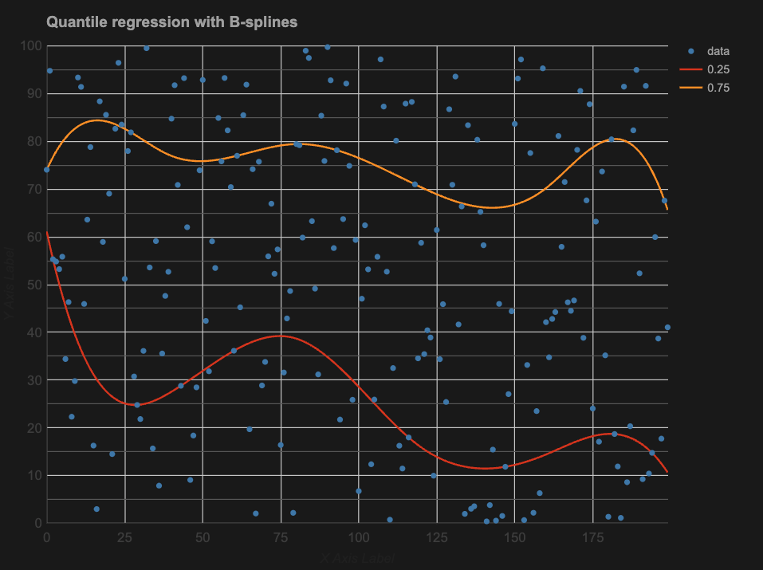

Find the fraction of the data points that are under the second regression quantile:

```raku
@rand-data.grep({ @q-funcs[1]($_.head) > $_.tail }).elems / @rand-data.elems
```

```
# 0.75
```

---

## Scope

Here is a quantile regression computation over a numerical vector:

```raku
#% html

my @vec-data = ((1...200) <</>> 6)».sin <<+>> random-real([-0.5, 0.5], 200);

say deduce-type(@vec-data);

my @q-funcs = quantile-regression(@vec-data, :12knots, probs => 0.5);
my @vec-data2 = (^@vec-data.elems) Z @vec-data;
say deduce-type(@vec-data2);

qr-plot(@vec-data2, @q-funcs, [0.5,], 
    :$backgroundColor,
    :$titleTextStyle,
    :$chartArea,
    legend => {
        position => 'right',
        textStyle => {
            color => '#dad5d5',
            fontSize => 12
        }
    },
    colors => [
        '#4285F4',
        '#EA4335'
    ],
    :$format, 
    div-id=>'scope-1'
);
```

```
# Vector(Atom((Numeric)), 200)
# Vector(Tuple([Atom((Int)), Atom((Numeric))]), 200)
```

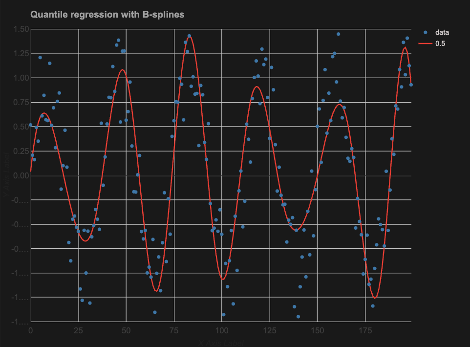


The second argument—the knots specification—can be an integer specifying the number of knots or a list of numbers specifying the knots of the B-spline basis:

```raku
my @q-funcs2 = quantile-regression(@rand-data, knots => @rand-data.map(*.head).pick(5).sort, probs => 0.5);
@q-funcs2[0](100)
```

```
# 57.364851711684125
```

Compare the result of `quantile-regression` above with `quantile-regression-fit` with the explicit specification of Chebyshev polynomials basis: 

```raku
#% html

my @basis = (^22).map(-> $order { -> $x { chebyshev-t($order, ($x - @vec-data.elems / 2) / (@vec-data.elems / 2)) } });

my @q-funcs-cheb = quantile-regression-fit(@@vec-data, :@basis, probs => 0.5);

qr-plot(@vec-data2, @q-funcs-cheb, [0.5,], 
    :$backgroundColor,
    title => "Quantile Regression with {@basis.elems} Chebyshev polynomials",
    :$titleTextStyle,
    :$chartArea,
    legend => {
        position => 'right',
        textStyle => {
            color => '#dad5d5',
            fontSize => 12
        }
    },
    colors => [
        '#4285F4',
        '#EA4335'
    ],
    :$format, 
    div-id=>'scope-cheb'
);
```

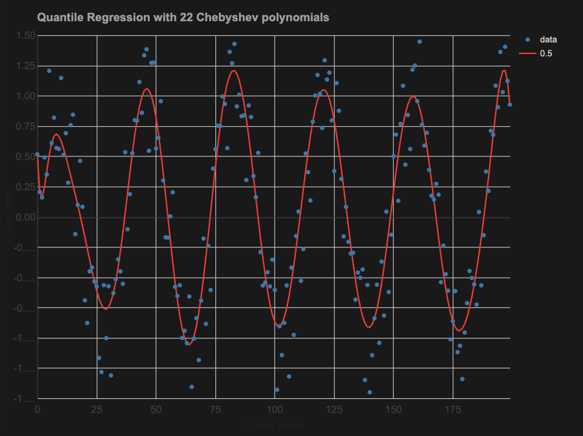

---

## Options

### Order (interpolation order)

```raku
#% html
my @q-funcs = [0, 1, 3].map({ quantile-regression(@vec-data2, :20knots, probs => 0.5, order => $_).head });

qr-plot(@vec-data2, @q-funcs, [0, 1, 3], 
    title => 'Interpolation orders',
    :$titleTextStyle, 
    :$chartArea, 
    legend => {
        position => 'right',
        textStyle => {
            color => '#dad5d5',
            fontSize => 12
        }
    }, 
    :$backgroundColor, 
    :$format, 
    div-id => 'order');
```

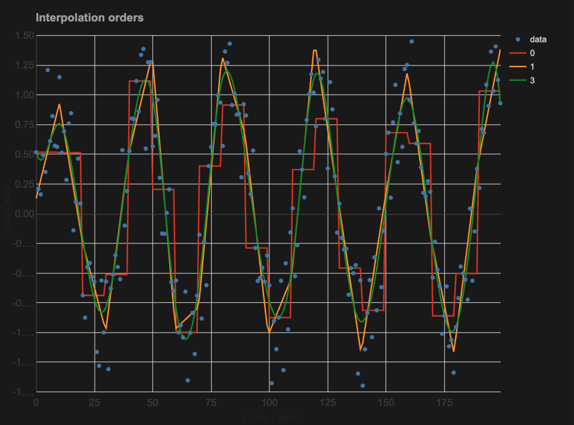

---

## Applications

### Fit for heteroscedastic data

Here is heteroscedastic data (the variance is not constant with respect to the predictor variable):

```raku
#% html
my @x-values = -3, -2.99 ... 3.01;
my @dist-data = @x-values.map({
    [$_, exp( - $_ ** 2) + random-variate(NormalDistribution.new(0, 0.15 * sqrt(abs(1.5 - $_) / 1.5)))]
});

js-google-charts('Scatter', 
    @dist-data,
    title => 'Distribution data',
    :$titleTextStyle,
    series => { 0 => {color => 'SteelBlue', pointSize => 2} },
    :$backgroundColor, 
    :$chartArea, 
    :$format,
    :700width,
    :450height,
    div-id => 'dist-data')
```

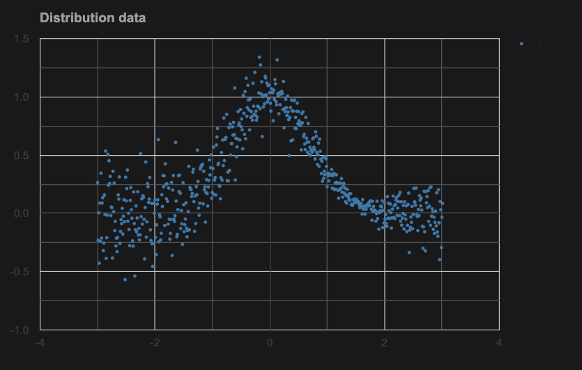

Find quantile regression fits:

```raku
my @probs = 0.1, 0.25, 0.5, 0.75, 0.9;
my @q-funcs = quantile-regression(@dist-data, :4knots, :@probs);

@q-funcs.elems
```

```
# 5
```


Plot the data and the regression quantiles:


```raku
#% html
qr-plot(@dist-data, @q-funcs, @probs,
    title => 'Distribution data fits',
    :$titleTextStyle, 
    :$chartArea,
    pointColor => 'Gray',
    legend => {
        position => 'right',
        textStyle => {
            color => '#dad5d5',
            fontSize => 12
        }
    }, 
    :$backgroundColor, 
    :$format, 
    div-id => 'dist-data-fits');
```

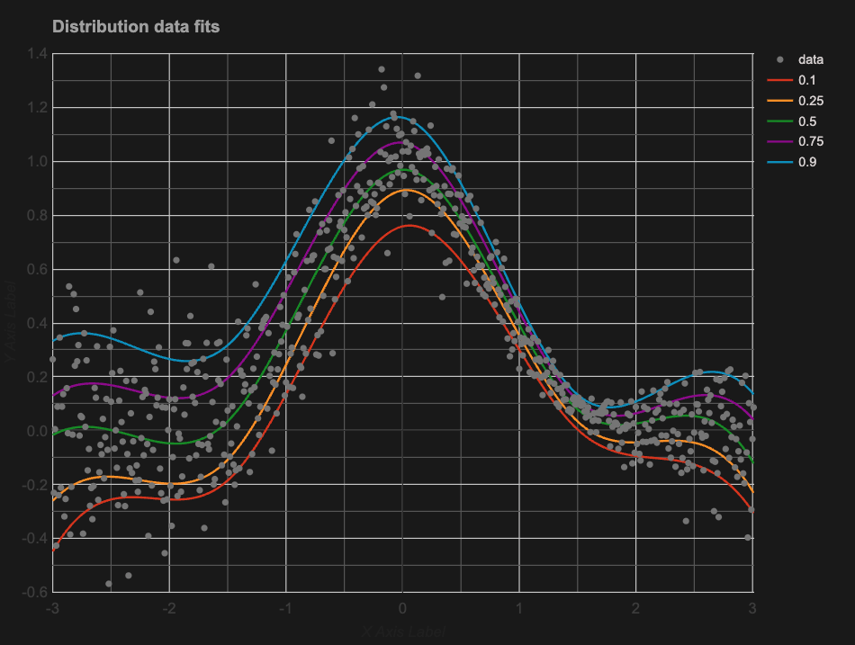

Note that the regression quantiles clearly outline the heteroscedastic nature of the data.

### Find variance anomalies

A certain contextual type of anomaly is a subset of points that have variance very different than other subsets. Using quantile regression we can (1) evaluate the regressor-dependent variance for each point using the regression quantiles $0.25$ and  $0.75$; and (2) find the points that have outlier variances.

Here we compute and plot the variance estimates for a signal:

```raku
#% html
my @q-funcs = quantile-regression(@dist-data, :4knots, probs => [0.25, 0.75]);

my @variances = @dist-data.map({ @q-funcs[1]($_.head) - @q-funcs[0]($_.head)});

js-google-charts('Line', 
    @variances, 
    :$backgroundColor,
    :$chartArea,
    :$format, 
    div-id => 'variances'
)
```

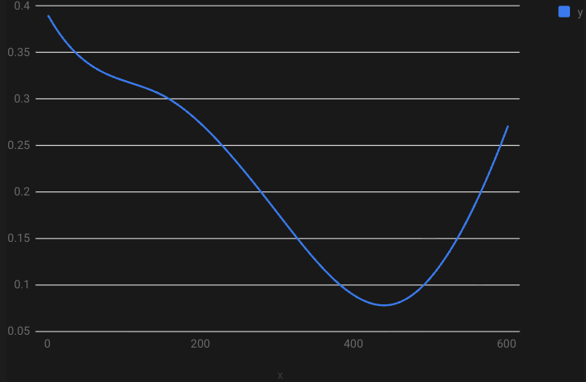

Find the lower and upper thresholds for the variance outliers:

```raku
my @median-distances = @variances <<->> median(@variances);
my ($lower-threshold, $upper-threshold) = quantile(@median-distances, [0.2, 0.8]);
```

```
# (-0.1282350702961753 0.120523139702508)
```

Find the outlier positions:

```raku
my @variance-outlier-positions = @median-distances.grep({ $_ < $lower-threshold || $_ > $upper-threshold }):k;
@variance-outlier-positions.elems
```

```
# 240
```

```raku
#% html
my @wide-data = @dist-data.kv.map(-> $i, @point {
    %(
        x => @point.head,
        data => @point.tail,
        outlier => $i ∈ @variance-outlier-positions ?? @point.tail !! Nil
    )
}).Array;

say deduce-type(@wide-data);

js-google-charts('Scatter', 
    @wide-data.map(*<x data outlier>),
    title => 'Distribution data and variance outliers',
    :$titleTextStyle,
    series => { 0 => {color => 'SteelBlue', pointSize => 2, title => 'data'}, 1 => {color => 'Pink', pointSize => 3} },
    legend => {
        position => 'right',
        textStyle => {
            color => '#dad5d5',
            fontSize => 12
        }
    },
    :$backgroundColor, 
    :$chartArea, 
    :$format,
    :700width,
    :450height,
    div-id => 'dist-data-outliers'
)
```

```
# Vector((Any), 602)
```

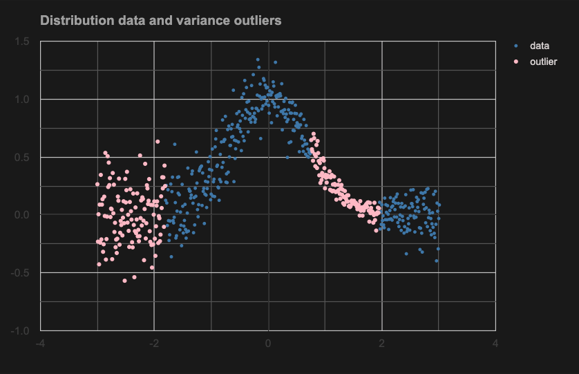

### Fit and anomalies for financial time series

Here is a financial time series:

```raku
my @fin-data = [3660854400, 236.16], [3662150400, 219.088], [3663360000, 217.166], [3664656000, 225.625], [3665865600, 232.085], [3667075200, 232.007], [3668371200, 244.466], [3669580800, 238.544], [3670790400, 237.622], [3672000000, 231.392], [3673209600, 230.854], [3674505600, 231.008], [3675715200, 229.316], [3677184000, 247.695], [3678393600, 243.312], [3679603200, 240.466], [3680812800, 240.851], [3682108800, 238.774], [3683318400, 228.162], [3684528000, 226.855], [3685737600, 222.857], [3686947200, 222.087], [3688156800, 236.468], [3689452800, 236.545], [3690662400, 242.235], [3691958400, 243.85], [3693254400, 241.158], [3694723200, 230.393], [3695932800, 231.008], [3697228800, 229.239], [3698438400, 227.163], [3699648000, 227.778], [3700857600, 231.008], [3702153600, 225.01], [3703363200, 220.703], [3704572800, 214.013], [3705868800, 212.167], [3707078400, 211.86], [3708374400, 201.094], [3709584000, 199.248], [3710793600, 198.249], [3712003200, 188.79], [3713212800, 193.326], [3714681600, 188.098], [3715891200, 188.943], [3717100800, 179.638], [3718310400, 156.953], [3719520000, 146.264], [3720816000, 141.573], [3722025600, 137.728], [3723321600, 133.652], [3724617600, 146.264], [3725913600, 124.04], [3727123200, 114.889], [3728592000, 112.658], [3729801600, 116.119], [3731011200, 99.124], [3732307200, 100.354], [3733516800, 112.89], [3734726400, 109.737], [3735936000, 117.58], [3737232000, 104.892], [3738441600, 99.0472], [3739737600, 103.277], [3740947200, 105.584], [3742156800, 101.278], [3743366400, 94.5872], [3744576000, 98.2016], [3745872000, 97.5096], [3747081600, 86.82], [3748291200, 94.7408], [3749500800, 86.8968], [3750710400, 65.98], [3752179200, 58.2904], [3753475200, 51.9848], [3754771200, 56.8288], [3756067200, 68.7488], [3757363200, 70.4408], [3758572800, 75.4392], [3760041600, 83.2056], [3761251200, 79.2], [3762460800, 79.04], [3763670400, 75.92], [3764966400, 74.64], [3766176000, 80.88], [3767385600, 79.68], [3768681600, 79.12], [3769891200, 82.72], [3771100800, 84.88], [3772396800, 80.48], [3773606400, 80.64], [3774816000, 64.08], [3776025600, 64.88], [3777321600, 74.72], [3778531200, 72.32], [3779740800, 70.4];

deduce-type(@fin-data)
```

```
# Vector(Tuple([Atom((Int)), Atom((Rat))]), 96)
```

Do a quantile regression fit and plot it:

```raku
#% html
my @q-funcs = quantile-regression(@fin-data, :20knots, probs=>0.5);

qr-plot(@fin-data, @q-funcs, [0.5, ],
    title => 'Distribution data fits',
    :$titleTextStyle, 
    :$chartArea,
    pointColor => 'Gray',
    legend => {
        position => 'right',
        textStyle => {
            color => '#dad5d5',
            fontSize => 12
        }
    }, 
    :$backgroundColor, 
    :$format, 
    div-id => 'fin-data-fits');
```

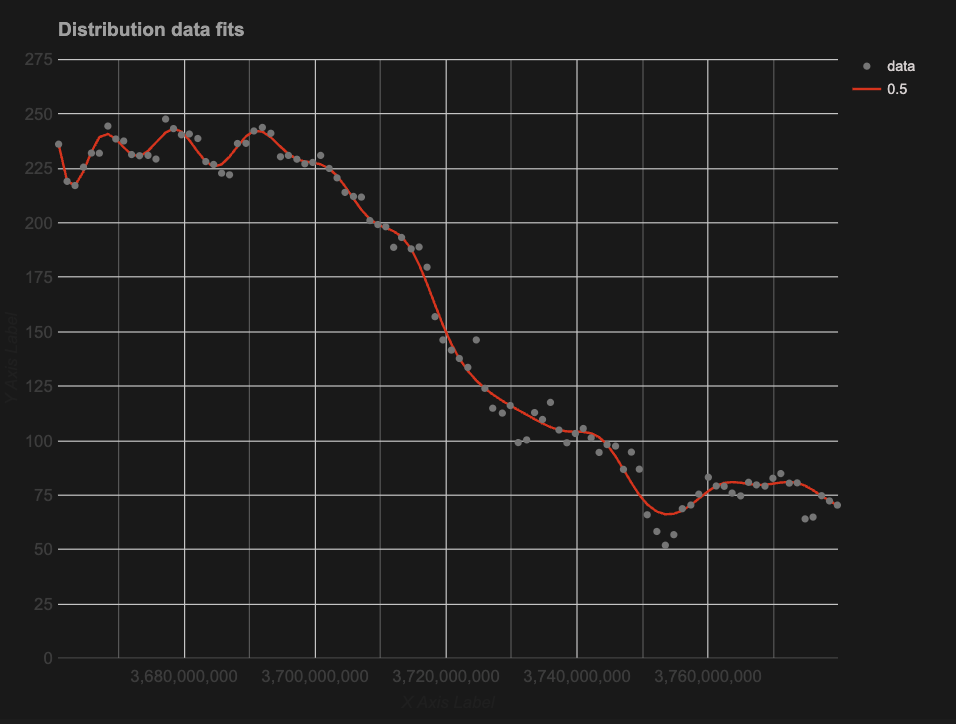

Here are the errors of the fit found:

```raku
#% html
#Dates are with epoch correction (from 1900-01-01 to 1970-01-01)
my @data = @fin-data.map( -> @row { (DateTime.new(Instant.from-posix(@row[0] - $date-offset)), (@q-funcs[0](@row[0]) - @row[1]) / @row[1]) });

js-google-charts('Scatter',
    @data,
    title => 'Financial data fit residuals',
    :$titleTextStyle, 
    :$backgroundColor,
    :$chartArea,
    areaOpacity => 0.7,
    seriesType => 'area',
    series => {
          0 => {
            type => 'area',
            lineWidth => 3,
            pointSize => 7,
            pointShape => 'circle'
        }
    },
    hAxis => {
        title => 'Date',
        format => 'yyyy-MM-dd'
    },
    legend => 'none',
    :$format, 
    div-id => 'fin-data-residuals'
)
```

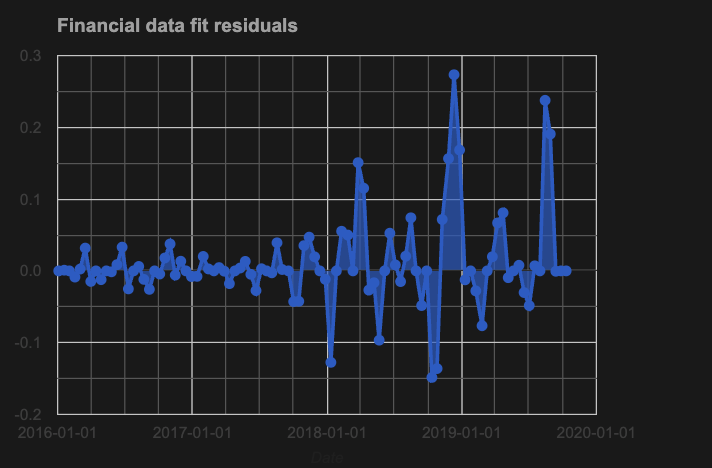

Find anomalies’ positions in the list of fit errors:

```raku
my @errors = @data.map(*.tail);
my @pos = outlier-identifier(@errors».abs, identifier => &splus-quartile-identifier-parameters);
@pos
```

```
# [51 56 57 70 71 73 74 75 91 92]
```

Plot the data, fit and anomalies:

```raku
#% html
my @wide-data = @fin-data.kv.map(-> $i, @point {
    %(
        x => DateTime.new(Instant.from-posix(@point.head - $date-offset)),
        data => @point.tail,
        fit => @q-funcs[0](@point.head),
        anomaly => $i ∈ @pos ?? @point.tail !! Nil
    )
}).Array;

say deduce-type(@wide-data);

js-google-charts('Scatter', 
    @wide-data.map(*<x data fit anomaly>),
    column-names => <x data fit anomaly>,
    title => 'Financial data, fit, and anomalies',
    :$titleTextStyle,
    series => { 
        0 => {color => 'Gray', pointSize => 2}, 
        1 => {color => 'SteelBlue', type => 'line', lineWidth => 3, pointSize => 0},
        2 => {color => 'Red', pointSize => 3},
    },
    legend => {
        position => 'right',
        textStyle => {
            color => '#dad5d5',
            fontSize => 12
        }
    },
    hAxis => {
        title => 'Date',
        format => 'yyyy-MM-dd'
    },
    :$backgroundColor, 
    :$chartArea, 
    :$format,
    :700width,
    :450height,
    div-id => 'fin-data-outliers'
)
```

```
# Vector((Any), 96)
```

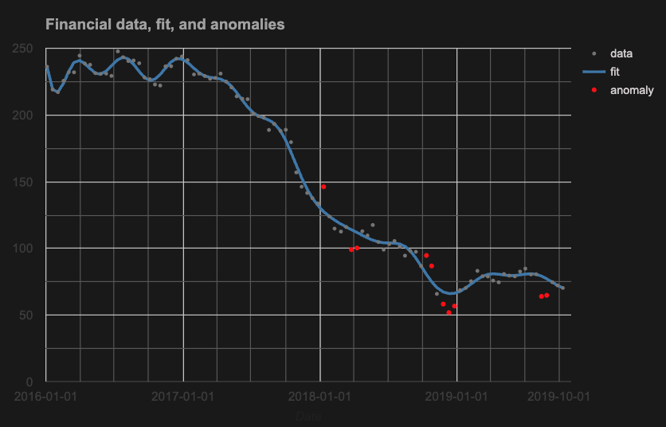

### Analyze temperature time series

Get temperature data:

```raku
my $url = "https://raw.githubusercontent.com/antononcube/MathematicaVsR/master/Data/MathematicaVsR-Data-Atlanta-GA-USA-Temperature.csv";
my @dsTemperature = data-import($url, headers => 'auto');
#@dsTemperature .= map({ $_.push( DateObject => DateTime.new(Instant.from-posix($_<Date> - $date-offset))) });
@dsTemperature .= deepmap({ $_ ~~ / ^ \d+ '-' / ?? Date.new($_) !! $_.Num });
@dsTemperature .= grep( 2020 ≤ *<Date>.year ≤ 2023);
deduce-type(@dsTemperature)
```

```
# Vector(Struct([AbsoluteTime, Date, Temperature], [Num, Date, Num]), 1461)
```

Convert the time series into a list of numeric pairs:

```raku
my @temp-data = @dsTemperature.map(*<AbsoluteTime Temperature>);
deduce-type(@temp-data)
```

```
# Vector(Vector(Atom((Numeric)), 2), 1461)
```

Compute quantile regression fits:

```raku
my @probs = 0.01, |(0.1, 0.3 ... 0.9), 0.99;
my @q-funcs = quantile-regression(@temp-data, :10knots, :@probs);
@q-funcs.elems
```

```
# 7
```

Plot the data and the regression quantiles:

```raku
#% html
qr-plot(@temp-data, @q-funcs, @probs,
    title => 'Temperature data fits',
    :$titleTextStyle, 
    :$chartArea,
    pointColor => 'Gray',
    hAxis => {
        title => 'Date',
        format => 'yyyy-MM-dd'
    },
    :date-plot,
    :$backgroundColor, 
    :$format, 
    div-id => 'temp-data-fits');
```

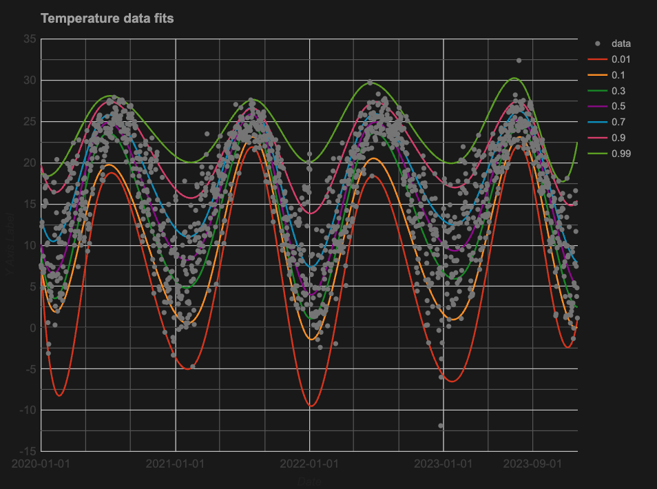

Find an estimate of the conditional Cumulative Distribution Function (CDF) at the date 2022-10-01:

```raku
my $focus-date = '2022-10-01';
my %row = @dsTemperature.grep(*<Date>.Str eq $focus-date).head;
%row
```

```
# {AbsoluteTime => 3873571200, Date => 2022-10-01, Temperature => 17.83}
```


```raku
#% html
my @q-func-values = @q-funcs.kv.map(-> $i, &f { [&f(%row<AbsoluteTime>), @probs[$i]] });

js-google-charts('Line', 
    @q-func-values, 
    title => "Temperature Data CDF at $focus-date",
    :$titleTextStyle,
    :$backgroundColor,
    :$chartArea,
    :$format,
    hAxis => {title => 'Temperature', titleTextStyle => {color => 'Gray'}},
    vAxis => {title => 'Probability', titleTextStyle => {color => 'Gray'}},
    div-id => 'CDF'
)
```

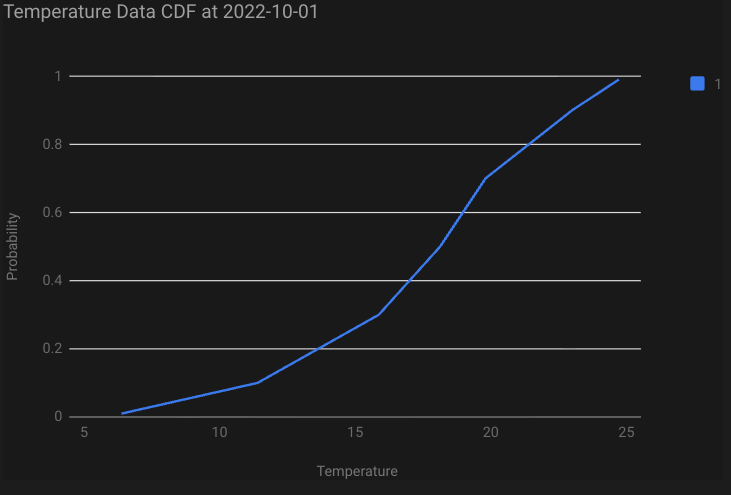

Find outliers in the temperature data—outliers are defined as points below or above the $0.02$ and $0.98$ regression quantiles respectively:

```raku
# Calculate regression quantiles
my @q-funcs = quantile-regression(@temp-data, 10, [0.02, 0.98]);

# Get the bottom and top outliers
my @wide-data = @temp-data.kv.map(-> $i, @point {
    %(
        x => DateTime.new(Instant.from-posix(@point.head - $date-offset)),
        data => @point.tail,
        bottom => @q-funcs[0](@point.head),
        top => @q-funcs[*-1](@point.head),        
        bottom-outlier => @q-funcs[0](@point.head) > @point.tail ?? @point.tail !! Nil,
        top-outlier => @q-funcs[1](@point.head) < @point.tail ?? @point.tail !! Nil,
    )
}).Array;

deduce-type(@wide-data)
```

```
# Vector((Any), 1461)
```

```raku
#% html
my @field-names = <x data bottom top bottom-outlier top-outlier>;
my @column-names = ['x', 'data', 'bottom regression quantile', 'top regression quantile', 'bottom outlier', 'top outlier'];

# Plot
js-google-charts('Scatter', 
    @wide-data.map(*{|@field-names}),
    :@column-names,
    title => 'Temperature data with outliers',
    :$titleTextStyle,
    series => { 
        0 => {color => 'DimGray', pointSize => 2, title => 'data'}, 
        1 => {color => 'LightBlue', type => 'line', lineWidth => 2, pointSize => 0}, 
        2 => {color => 'Pink', type => 'line', lineWidth => 2, pointSize => 0}, 
        3 => {color => 'DodgerBlue', pointSize => 3},
        4 => {color => 'Red', pointSize => 3},
    },
    legend => {
        position => 'right',
        textStyle => {
            color => 'DarkGray',
            fontSize => 12
        }
    },
    :$backgroundColor, 
    chartArea => {
        :$backgroundColor,
        left => 50,
        right => 200,
        top => 60, 
        bottom => 50
    },
    hAxis => {
        title => 'Date',
        titleTextStyle => {color => 'Gray'},
        format => 'yyyy-MM-dd'
    },
    vAxis => {
        title => 'Temperature, ℃',
        titleTextStyle => {color => 'Gray'}
    },
    :$format,
    :900width,
    :400height,
    div-id => 'temp-data-outliers'
)
```

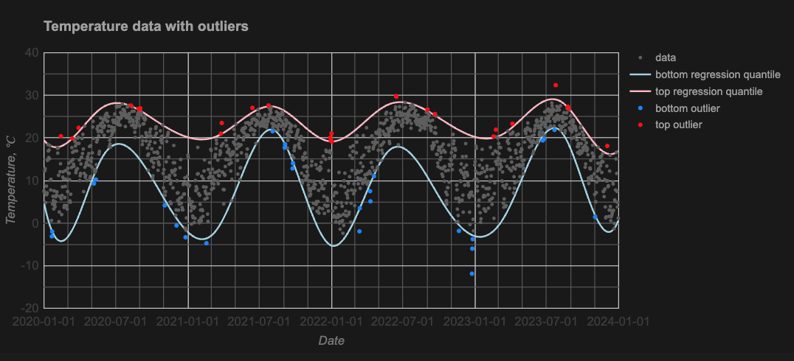

---

## Possible Issues

### Slow computations

Because of the linear-programming formulation, computations can be slow for certain data and knot specifications.

### Fitting for probabilities 0 and 1

For most data, quantile-regression fits for probabilities $0$ and $1$ *might or might not* produce regression quantiles that are too far away from the data.

Find and plot regression quantiles for probabilities $0$ and $0.5$:

```raku
#% html
my @probs = 0, 0.5;
my @q-funcs = quantile-regression(@dist-data, :6knots, :@probs);

qr-plot(@dist-data, @q-funcs, @probs,
    title => 'Regression quantiles for probabilities 0 and 0.5',
    :$titleTextStyle, :$chartArea, :$backgroundColor, :$format,
    div-id => 'endpoint-probs-low');
```

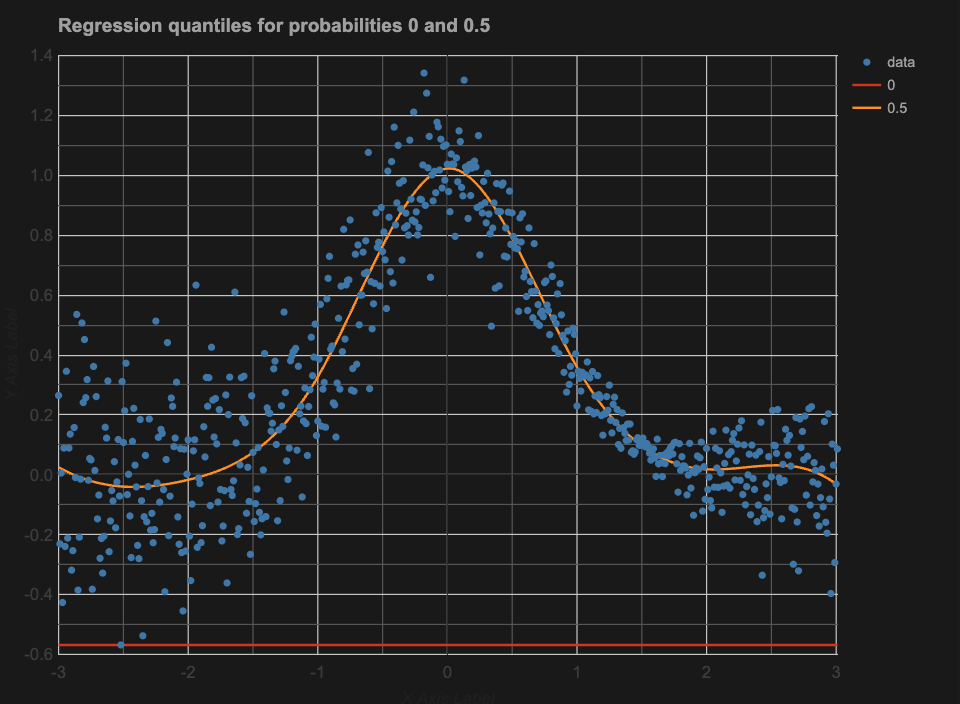

Find and plot regression quantiles for probabilities $0.5$ and $1$:

```raku
#% html
my @probs = 0.5, 1;
my @q-funcs = quantile-regression(@dist-data, :6knots, :@probs);

qr-plot(@dist-data, @q-funcs, @probs,
    title => 'Regression quantiles for probabilities 0.5 and 1',
    :$titleTextStyle, :$chartArea, :$backgroundColor, :$format,
    div-id => 'endpoint-probs-high');
```

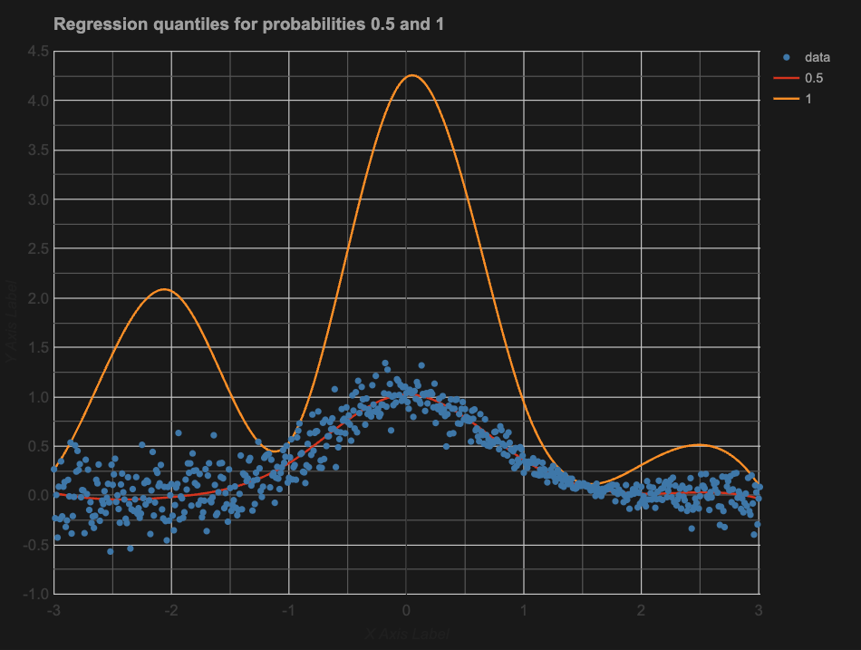


### Overfitting

Consider the following nonlinear data:

```raku
#% html
my @temp-data2 = @temp-data[0 ..^ 730];

js-google-charts('Scatter', @temp-data2,
    title => 'Partial temperature data',
    :$titleTextStyle, :$backgroundColor, :$chartArea, :$format,
    div-id => 'partial-temperature-data');
```

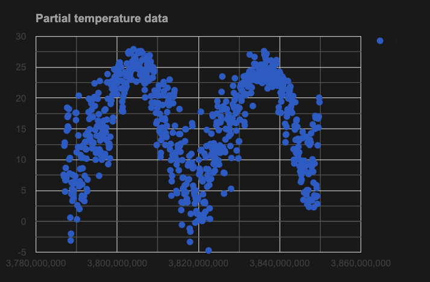

Make quantile-regression fits with 20 and 90 knots, respectively:

```raku
my &q-func20 = quantile-regression(@temp-data2, :20knots, probs => 0.5, order => 2).head;
my &q-func90 = quantile-regression(@temp-data2, :90knots, probs => 0.5, order => 2).head;
```

Plot the regression quantiles and the data. The regression quantile computed with 90 knots is overfitted:

```raku
#% html
qr-plot(@temp-data2, [&q-func20, &q-func90], [20, 90],
    title => 'Overfitting with B-spline knots',
    :$titleTextStyle, :$chartArea, :$backgroundColor, :$format,
    div-id => 'overfitting');
```

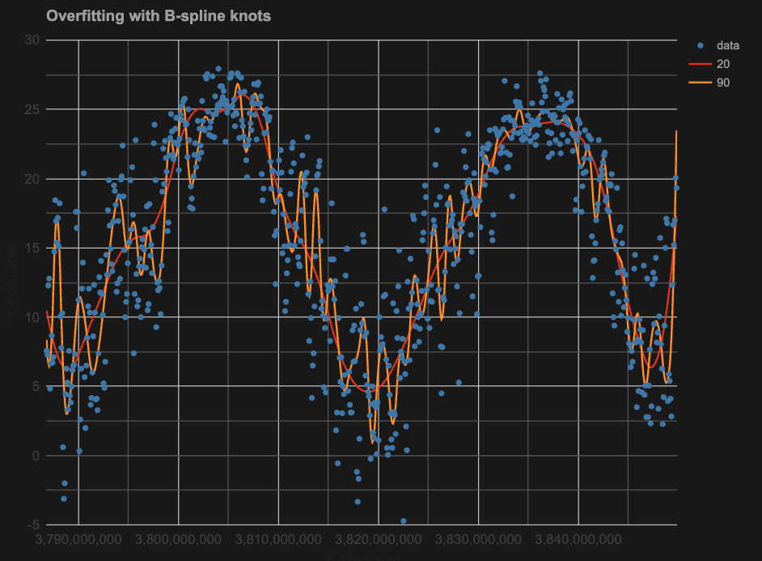

### Intersecting regression quantiles

When regression quantiles are overfitted, an estimate of the conditional cumulative distribution function (CDF) can be problematic: the estimated CDF need not be monotonically increasing.

Compute regression quantiles using too many knots:

```raku
#% html
my @probs = 0.01, |(0.1, 0.2 ... 0.9), 0.99;
my @q-funcs = quantile-regression(@dist-data, :30knots, :@probs);

qr-plot(@dist-data, @q-funcs, @probs,
    :1200width, :400height,
    title => 'Potentially intersecting regression quantiles',
    :$titleTextStyle, :$chartArea, :$backgroundColor, :$format,
    div-id => 'intersecting-quantiles');
```

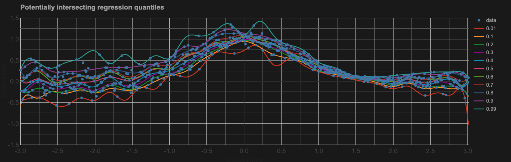

Here is the estimated conditional CDF at a selected predictor value:

```raku
#% html
my $x = @dist-data[100].head;
my @q-func-values = @q-funcs.kv.map(-> $i, &f { [&f($x), @probs[$i]] });

js-google-charts('Line', @q-func-values,
    title => "Distribution-data CDF at $x",
    :$titleTextStyle, :$backgroundColor, :$chartArea, :$format,
    hAxis => {title => 'Response'},
    vAxis => {title => 'Probability'},
    div-id => 'intersecting-cdf');
```

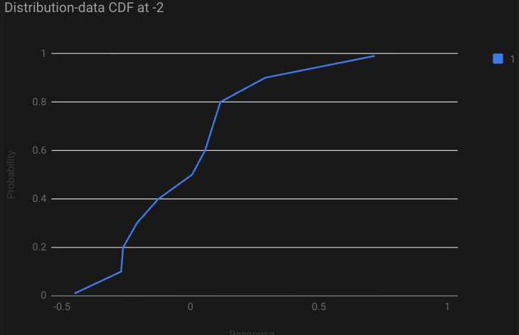

### Rescaling

For certain data, it is beneficial to rescale predictor values, predicted values, or both before computing quantile regression:

```raku
my @fin-data2 = 10532750, 1342440, 714972, 1289802, 1302765, 814231, 830680, 416649, 80017, 24343, 1808, 1939, 25848, 32532, 21807, 26108, 12581, 36315, 34544, 3827, 7631, 7259;
my @probs = 0.2, 0.5, 0.8;
my @q-funcs = quantile-regression(@fin-data2, :4knots, :@probs);
@q-funcs.map({ .(10) })
```

```
# (-147456.13833607163 34097.130202261316 135002.94911736384)
```

```raku
#% html
my $min = @fin-data2.min;
my $max = @fin-data2.max;
my @fin-data2r = @fin-data2.map({ ($_ - $min) / ($max - $min) });
my @q-funcs = quantile-regression(@fin-data2r, :4knots, :@probs);

say @q-funcs.map({ .(10) });
my @fin-data2r-pairs = (^@fin-data2r.elems) Z @fin-data2r;
qr-plot(@fin-data2r-pairs, @q-funcs, @probs,
    title => 'Rescaled financial data fits',
    :$titleTextStyle, :$chartArea, :$backgroundColor, :$format,
    div-id => 'rescaling');
```

```
# (-0.014173863870494362 0.0030661198402064005 0.012647961513543976)
```

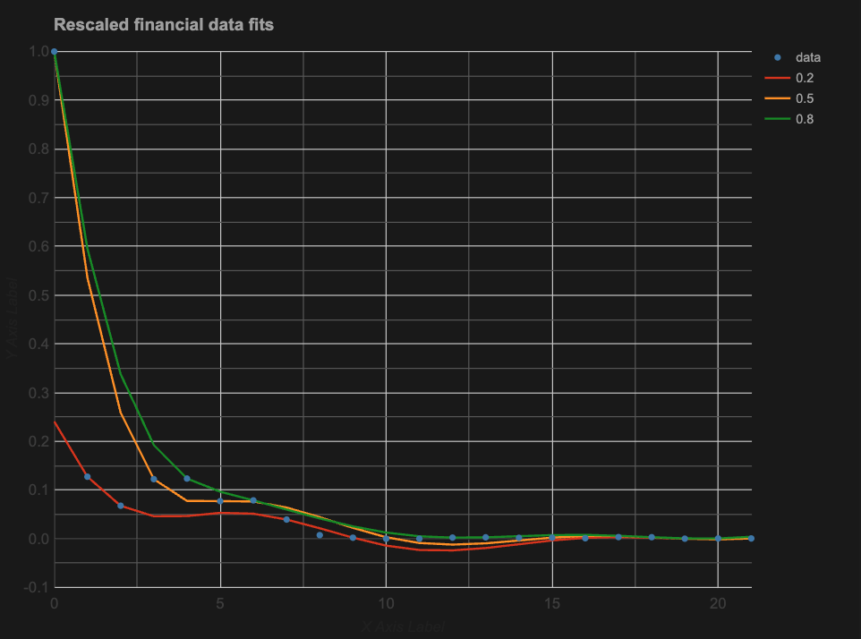

------

## References

[AAp1] Anton Antonov, 
[QuantileRegression, Raku package](https://github.com/antononcube/Raku-Math-QuantileRegression),
(2026),
[GitHub/antononcube](https://github.com/antononcube).

[AAp2] Anton Antonov, 
[QuantileRegression, Python package](https://pypi.org/project/QuantileRegression/),
(2024),
[PyPI.org/antononcube](https://pypi.org/user/antononcube/).

[AAp3] Anton Antonov,
[QuantileRegression](https://resources.wolframcloud.com/FunctionRepository/resources/QuantileRegression/),
(2019),
[Wolfram Function Repository](https://resources.wolframcloud.com/FunctionRepository).